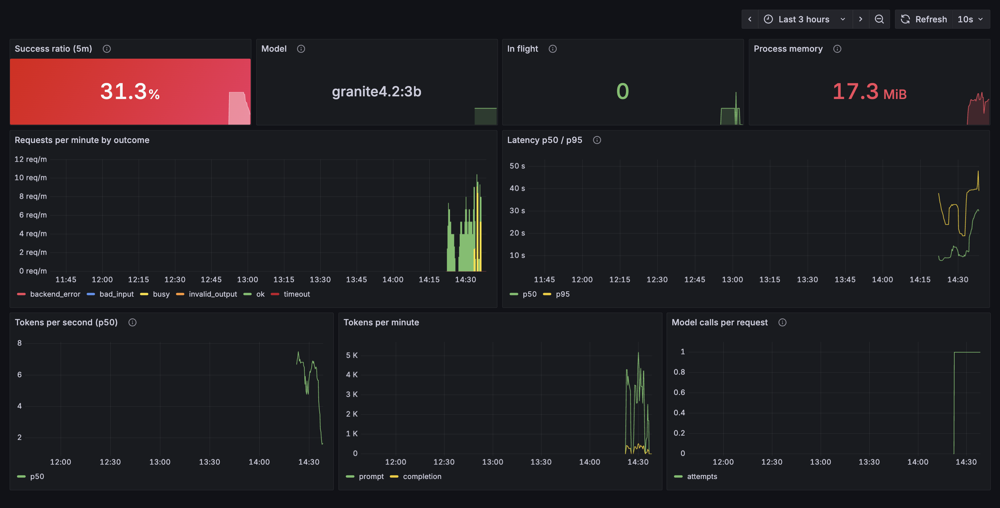

# LLM error classifier

A small self-hosted service that turns raw software error messages or stack traces into structured JSON:

```bash
curl -s localhost:8080/classify -H 'Content-Type: application/json' \
  -d '{"error": "TypeError: Cannot read properties of undefined (reading '"'"'map'"'"')\n    at renderProducts (app.js:42)"}'
```

```json
{
  "category": "runtime_error",
  "severity": "medium",
  "summary": "renderProducts tries to call map on undefined, causing a runtime error.",
  "suggested_action": "Fix the undefined value before calling map on it in renderProducts."
}
```

Runs an open-weights model locally on CPU via Ollama (no external APIs). Starts via `docker compose up -d` on a standard Linux VPS without GPU. Default model: IBM Granite 4.2 3B (Apache 2.0).

## Quick start

Requirements: Docker with Compose v2, 4 CPU cores, 8 GB RAM (see [Resources](#resources)).

```bash
cp .env.example .env              # defaults work as is
docker compose up -d --build      # first start downloads the model (~2.2 GB)
docker compose logs -f model-init # watch the download
curl -s localhost:8080/readyz     # {"status":"ready"} once the model is present

# with Prometheus and Grafana
docker compose --profile observability up -d
# Grafana: http://localhost:3000 (dashboard "LLM error classifier"), Prometheus: http://localhost:9090
```

Initial model load takes ~18–35 s; warm requests take ~7 s on a 4-core machine.

## API

| Method and path | Purpose |
|---|---|
| `POST /classify` | Body `{"error": "<text>"}` (`application/json`) or the raw text with `Content-Type: text/plain`. Returns the four fields below. |
| `GET /healthz` | Liveness, always 200 while the process is up. |
| `GET /readyz` | 200 when the model backend answers and the configured model is present, otherwise 503. |
| `GET /metrics` | Prometheus metrics. |

Response fields: `category`, `severity`, `summary`, `suggested_action`.
- Categories (`internal/entity/classification.go`): `syntax_error`, `runtime_error`, `network_error`, `timeout`, `database_error`, `auth_error`, `config_error`, `dependency_error`, `resource_exhausted`, `filesystem_error`, `unknown`.
- Severities: `low` (warning/cosmetic), `medium` (feature fails, workaround exists), `high` (major functionality down), `critical` (full outage, data loss, security breach).

Errors (`{"error": "<fixed message>", "code": "<code>"}`):

| Status | code | When |
|---|---|---|
| 400 | `empty_input`, `bad_request` | empty text, malformed JSON |
| 413 / 415 | `bad_request` | body over 256 KiB, unsupported content type |
| 429 | `busy` (with `Retry-After`) | no free model slot within `QUEUE_WAIT` |
| 502 | `invalid_model_output`, `model_unavailable` | the model kept returning an unusable answer, or the backend is down |
| 504 | `model_timeout` | the model did not answer within `LLM_TIMEOUT` |

Raw error text is not logged; backend errors are logged at debug level. Mid-request client disconnects count as `timeout` in metrics.

## Configuration

Settings are configured via environment variables (see [`.env.example`](.env.example)):

| Variable | Default | Meaning |
|---|---|---|
| `LLM_MODEL` | `granite4.2:3b` (in `.env.example`; required) | Ollama model tag, pulled automatically by `model-init` |
| `LLM_BASE_URL` | `http://ollama:11434/v1` | any OpenAI-compatible backend |
| `LLM_API_KEY` | empty | bearer token for backends that need one |
| `LLM_REASONING_EFFORT` | `none` | passed through; stops reasoning models from thinking |
| `LLM_MAX_TOKENS`, `LLM_TIMEOUT` | `400`, `120s` | per model call |
| `MAX_CONCURRENT`, `QUEUE_WAIT` | `1`, `30s` | slots in front of the model and how long to wait for one |
| `MAX_ATTEMPTS`, `MAX_INPUT_CHARS` | `2`, `4000` | total model calls per request on invalid output (2 = one retry); input cut length |
| `CLASSIFY_LANGUAGE` | `English` | language of `summary` and `suggested_action` |
| `OLLAMA_CPUS`, `OLLAMA_MEMORY` | `4`, `8g` | container limits |
| `OLLAMA_NUM_PARALLEL` | `1` | parallel requests inside Ollama; keep equal to `MAX_CONCURRENT` |
| `*_PORT` | 8080, 11434, 9090, 3000 | host ports, all bound to 127.0.0.1 |
| `BUILD_PROXY`, `HTTPS_PROXY` | empty | only when the host reaches the internet through a proxy |

To update or swap models, change `LLM_MODEL` in `.env` and run `docker compose up -d` (`model-init` pulls the new tag into the volume). Remove old models with `docker compose exec ollama ollama rm <tag>` (if using a proxy, pass `-e HTTPS_PROXY= -e HTTP_PROXY=`). Any OpenAI-compatible backend (llama.cpp `llama-server`, vLLM) can replace Ollama by setting `LLM_BASE_URL`.

## Architecture

```
client ──HTTP──> classifier (Go) ──OpenAI-compatible API──> Ollama (CPU) ── volume ollama-models
                    │                                          ▲
                    ├─ /metrics ──> Prometheus ──> Grafana     └─ model-init: `ollama pull $LLM_MODEL`
                    └─ /healthz, /readyz
```

Structure: `internal/entity` (domain), `internal/usecase` (classifier logic, slots, retries), `internal/adapter` (OpenAI client, metrics), `internal/controller/httpctl` (HTTP handlers). Enforced via `depguard`.

Request lifecycle:
1. Input validation rejects empty text and truncates long input to `MAX_INPUT_CHARS` (keeping head and tail).
2. Concurrency semaphore (`MAX_CONCURRENT` slots). Calls waiting over `QUEUE_WAIT` return 429.
3. Prompt contains definitions, two examples, and injection defense. Called with `temperature: 0`, JSON schema in `response_format`, `reasoning_effort: none`.
4. Output is stripped of markdown code fences, normalized, and validated against allowed dictionaries.
5. If invalid, the request is retried up to `MAX_ATTEMPTS` (temperature 0.3) before returning 502. Backend errors and timeouts fail fast without retries.

## Model choice

Comparison across 40 samples on CPU (Ollama limited to 4 CPUs, 8 GB RAM, Q4 quantization):

| Model | License | Disk | Peak RAM | Category acc. | Severity exact | Severity ±1 | Valid answers | Latency mean / p95 |
|---|---|---|---|---|---|---|---|---|
| qwen3.5:0.8b | Apache 2.0 | 1.3 GB | 2.3 GiB | 82.5 % | 40.0 % | 80.0 % | 100 % | 18.0 s / 21.7 s |
| qwen3.5:2b | Apache 2.0 | 2.7 GB | 3.4 GiB | 90.0 % | 45.0 % | 90.0 % | 97.5 % | 13.8 s / 29.2 s |
| qwen3.5:4b | Apache 2.0 | 3.3 GB | 4.3 GiB | 97.5 % | 45.0 % | 95.0 % | 100 % | 16.1 s / 26.8 s |
| granite4.2:3b | Apache 2.0 | 2.2 GB | 2.6 GiB | 92.5 % | 57.5 % | 97.5 % | 100 % | 11.0 s / 16.8 s |
| phi4-mini (3.8B) | MIT | 2.5 GB | 3.5 GiB | 90.0 % | 42.5 % | 95.0 % | 100 % | 8.0 s / 13.2 s |
| gemma4:e2b | Apache 2.0 | ~7 GB | 5.2 GiB | 92.5 % | 65.0 % | 95.0 % | 100 % | 12.0 s / 17.0 s |

Full evaluation reports: [`docs/model-comparison/`](docs/model-comparison).

- **Default (Granite 4.2 3B)**: Apache 2.0, lowest RAM footprint among accurate models (2.6 GiB peak, fits 4 GB VPS), 2.2 GB download, 100% valid JSON, 92.5% category accuracy, 97.5% severity within ±1 level.
- **Alternatives**: `qwen3.5:4b` for highest category accuracy (97.5%, +1.3 GiB RAM, slower); `phi4-mini` for speed (MIT, fastest); `gemma4:e2b` for calibrated severity (65.0% exact, requires 5.2 GiB RAM, ~7 GB disk).

Measurement caveats:
- **Sample size**: 40 samples means each sample is 2.5 points (noise margin ±2.5%). The labels were written by one person, and severity is subjective.
- **Severity ±1 baseline**: The dataset contains 15 `medium`, 15 `high`, 6 `low`, 4 `critical`. Constant `medium` scores 90% within ±1 (37.5% exact); Granite's 97.5% is 3 samples above baseline.
- **Critical incident recall**: Granite scored 0/4 on critical samples (classified as `high` 3 times, `medium` once). Severity is a triage signal, not an automated pager trigger.
- **Latency calculation**: Excludes failed requests (`qwen3.5:2b` had one 120 s timeout excluded from its 13.8 s mean).
- **Host differences**: Docker Desktop on Mac timings are higher (11–13 s mean) due to VM overhead; see [the demonstration](#demonstration-on-a-clean-linux-host) for Linux host timings (8.9 s mean).

Reproduce comparison:
`docker compose exec ollama ollama pull phi4-mini`
`scripts/compare.sh "granite4.2:3b phi4-mini" <ollama-container>`
`scripts/stats.sh <file>`

## Resources

Measured with Granite 4.2 3B (Q4) and Ollama limited to 4 CPUs / 8 GB RAM:

| | |
|---|---|
| **Disk** | model 2.2 GB (volume `ollama-models`) + Ollama image 4.3 GB + classifier image 19 MB. Plan for **10 GB** including the OS layer cache and a second model for upgrades |
| **RAM** | idle Ollama ~90 MB; with the model loaded **2.6 GiB peak** under load; classifier process ~20 MB. Plan for **4 GB** minimum, 8 GB for comfort or larger models |
| **CPU** | inference uses all allotted cores: ~400 % of 4 cores while a request runs, idle otherwise. 2 cores work but roughly double the latency |
| **Latency** | first request after start (model load) 18–35 s; warm request **~7 s**, mean 9 s (Linux) to 11–13 s (Mac, Docker Desktop) over the 40-sample set (stack traces are slower: prompt processing grows with input length); p95 15–19 s |
| **Throughput** | one request at a time, about 5–8 requests per minute. Parallel requests do not help on CPU; they wait for a slot (`QUEUE_WAIT`) and then get 429 |

## Demonstration on a clean Linux host

No VPS was at hand, so the steps above were run unchanged (`git clone`, `cp .env.example .env`, `docker compose --profile observability up -d --build`) on a separate Linux machine: Ubuntu 24.04, kernel 6.8, 20 cores, 15 GB RAM, Docker 29, Compose v5, no GPU. Ollama was limited to 4 CPUs and 8 GB, so the numbers describe a 4-vCPU VPS. `registry.ollama.ai` is unreachable from that host, so the model volume was copied from the laptop (see the last note in the deployment section); the stack was ready in 15 s.

| Measured on the Linux host (granite4.2:3b) | |
|---|---|
| First request after start (model loaded from disk) | 18 s |
| Warm request | 6.7-6.9 s |
| 40-sample evaluation, sequential | 40/40 valid, category accuracy **95.0 %**, severity exact 52.5 %, within one level 97.5 % |
| Latency over the 40 samples | mean 8.9 s, p50 8.3 s, p95 15.1 s, max 16.9 s |
| Ollama container | CPU ~394 % average (limit 400 %), RAM peak **2.9 GiB**, idle ~0 % CPU |
| Burst of 8 parallel requests (1 slot, `QUEUE_WAIT` 30 s) | 5 answered (about 6 s apart, no degradation), 3 rejected with `429 busy` after exactly 30 s |

Full benchmark report: [`docs/model-comparison/vps-granite.md`](docs/model-comparison/vps-granite.md).

## Monitoring

`docker compose --profile observability up -d` starts Prometheus (scrapes `classifier:8080/metrics` every 15 s, 15 days retention) and Grafana with the "LLM error classifier" dashboard.

Metrics (`classifier_*`): `requests_total{outcome}`, `request_duration_seconds`, `in_flight`, `llm_attempts`, `prompt_tokens_total`, `completion_tokens_total`, `tokens_per_second`, `model_info{model}`.
Outcomes: `ok`, `invalid_output`, `backend_error`, `timeout`, `busy`, `bad_input`. Model CPU/RAM are monitored via `docker stats`.



The screenshot is from the Linux host during the evaluation run; [an earlier one](docs/grafana-dashboard-mac-burst.png) shows two bursts of parallel requests, where the rejected `busy` requests pull the success ratio down.

## Evaluation

`eval/dataset.jsonl` contains 40 labelled errors across languages and technologies (including stack traces, non-English samples, and prompt-injection tests).

```bash
make eval                       # against http://localhost:8080
go run ./cmd/evaluate -url http://localhost:8080 -dataset eval/dataset.jsonl -label my-model
```

Runs requests sequentially (with a warm-up call) and outputs `eval/results/<label>.md` and `.json` containing category accuracy, severity exact/±1 rates, latency percentiles, and per-category recall.

## Deploying on a clean Linux VPS

Target: Ubuntu 22.04/24.04 or Debian 12, 4 vCPU, 8 GB RAM (4 GB minimum for Granite 3B), 20 GB disk, no GPU.

```bash
# 0. Minimal images may lack curl and git
sudo apt-get update && sudo apt-get install -y curl git

# 1. Docker Engine and the Compose plugin (official convenience script)
curl -fsSL https://get.docker.com | sudo sh
sudo systemctl enable --now docker        # Docker, and with it the stack, starts on boot

# 2. The project
git clone https://github.com/Code-oclock/llm-error-classifier.git
cd llm-error-classifier
cp .env.example .env
${EDITOR:-nano} .env                      # set OLLAMA_CPUS / OLLAMA_MEMORY to what the VPS has

# 3. Start (downloads the model once into the ollama-models volume)
sudo docker compose up -d --build
sudo docker compose logs -f model-init    # wait for the download to finish
curl -s localhost:8080/readyz

# 4. Optional dashboards
sudo docker compose --profile observability up -d
```

Operations notes:
- **Autostart**: Services specify `restart: unless-stopped`. `model-init` checks volume presence (`ollama show`) and exits cleanly on reboot without requiring internet access.
- **Persistence**: Models are stored in named volume `ollama-models`; preserved across `docker compose down` (do not pass `-v`) and rebuilds.
- **Sizing**: Set `OLLAMA_CPUS` to host vCPUs and `OLLAMA_MEMORY` to RAM minus ~1 GB. For 4 GB RAM systems use `granite4.2:3b` (peak 2.9 GiB on Linux). 2 vCPUs doubles inference latency.
- **Network exposure**: Ports bind to `127.0.0.1` by default; use reverse proxy (nginx/Caddy) with TLS and authentication for public access.
- **Updates**: `git pull && docker compose up -d --build`.
- **Air-gapped / blocked registry transfer**: If `registry.ollama.ai` is unreachable:
  `docker run --rm --entrypoint tar -v <project>_ollama-models:/m:ro ollama/ollama:0.40.17 cf - -C /m . | ssh server 'cat > models.tar'`
  Unpack archive into the server's `ollama-models` volume before `docker compose up -d`.

## Limitations

- Category accuracy on boundary cases is ~92.5% (~7% errors, e.g. connection pool exhaustion as timeout, rate limit as runtime error).
- CPU inference latency is several seconds per request; designed for asynchronous log/alert triage, not real-time user-facing flows.
- Critical incidents are under-detected (Granite scored 0/4 critical recall); do not trigger automated paging based on severity alone.
- Prompts are English-optimized; `CLASSIFY_LANGUAGE` sets response language, but non-English stack traces have only been spot-checked (3 samples).
- Inputs are constrained by character count (`MAX_INPUT_CHARS`, default 4000), not tokens; dense CJK text may exceed 4096-token context.
- `tokens_per_second` in Grafana includes queue wait time.
- No built-in authentication: keep bound to localhost or place behind an authenticating reverse proxy.

## Development

```bash
make check      # gofumpt/gci formatting, golangci-lint (depguard, gosec, ...), go test -race
make hooks      # run format and lint before each commit
```

CI runs linters and tests on pull requests and pushes to `main`. Unit tests use fake HTTP backends (`httptest`) without requiring a running model.
